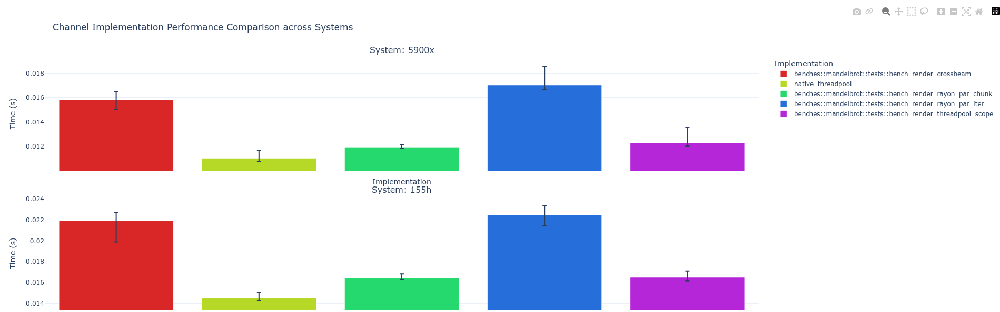
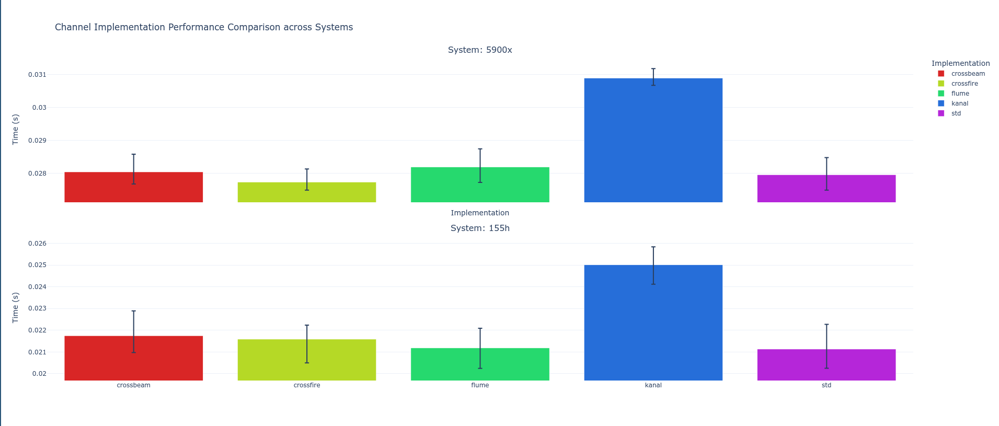

# Rust

Rust is a systems programming language that offers high performance combined
with a powerful high-level typing and ownership system which lets you
confidently write reliable and efficient software.

Rust is an interesting language for the PACE project because of the following
properties:

- Native compiled binaries that offer performance rivalling C and C++.
- Memory safety semantics that grant C++-like memory flexibility without using a
    garbage collector.
- Iterator semantics that make it easy to write astronomy code without getting
    lost in `for` loops.
- Trivial parallelization using said iterators.
- Memory and data-race safe parallelization if parallel iterators are not
    applicable.
- Excellent build system and library ecosystem.
- Easy FFI integration with C and C++ code.

## Parallelization

Rust contains many different concepts to organize parallelism both in the standard library and through (library) crates. Below we briefly discuss some of the most powerful concepts followed by a brief section on some current crates.

### Thread scope

Within Rust the lifetime of objects as well as exclusive ownership need to be guaranteed. This allows Rust to provide memory safety without a garbage collector. However, the semantics of moving objects into threads complicates returning that object to the caller once the thread has joined. Similarly, providing a reference to an object for a thread might result in the reference outlasting the lifetime of the object.

To address this thread scopes are introduced. Both in several crates as well as in the standard library. With these scopes the lifetime of threads is guaranteed and so objects can be used within them safely. The lifetime of all threads spawned within the scope is guaranteed to be over when the scope closes. Should the threads fail to join the scope will block indefinitely.

```Rust
fn processor(work: &mut [_]) {
    thread::scope(|s| {
        for item in work.into_iter() {
            s.spawn(move || {
                process(item);
            });
        }
    });
}
```

### Chunk

Rust has many built in functions to operate on slices that work equally well for Arrays and Vectors. The most important return an iterator of sub-slices with the last chunk being smaller if the work is not dividable. These functions are `chunks` and `chunks_mut`. Additionally methods like `chunks_exact` and `rchunks` exist.

These mechanism of work division in Rust are highly favorable to distribute the work across threads and nodes (sharding).

```Rust
fn processor(work: &mut [_]) {
    let n_workers = num_cpus::get();
    let chunks: Vec<&mut [_]> = work.chunks_mut(n_workers).collect();
    std::thread::scope(|s| {
        for chunk in chunks.into_iter() {
            s.spawn(move || {
                process(chunk);
            });
        }
    });
}
```

Work distributed in chunks can better utilize CPU L1 and L2 caches by tuning the chunk size to the CPU heuristics. Additionally, it allows to support tiling implementations of dense computations.

### Channels

Channels are FIFO message queues using tx & rx pairs with additional primitives. Beyond their basic function they allow to signal termination through the closing of the tx channels. Channels can be cloned allowing for multi-producer and or multi-producer setups. Effectively, channels combine queues with other language constructs like conditions or atomic variables in one cohesive package.

```Rust
#![feature(mpmc_channel)] // Required because std::mpmc is still in nightly.

fn main() {
    // Create a multiple-producer, multiple-consumer channel pair
    let (tx, rx) = std::sync::mpmc::channel();

    // Create a thread to put work into the channel
    std::thread::spawn(move || {
        for i in 0..15 {
            tx.send(i).expect("receiver hung up");
        }
    });

    // Create multiple worker threads to consume the work
    std::thread::scope(|s| {
        for worker in 0..5 {
            let cloned_rx = rx.clone();
            s.spawn(move || {
                while let Ok(value) = cloned_rx.recv() {
                    println!("worker {}: {}", worker, value);
                }
            });
        }
    });
}
```

### Iterators

Through Rust [extension traits](https://rust-lang.github.io/rfcs/0445-extension-trait-conventions.html) we can add additional operators to existing types. Used by [Rayon](https://docs.rs/rayon/latest/rayon/) to add parallel iterators that can be applied to slices, Arrays and Vectors. Notable new iterators include `par_iter` for element-wise iteration and `par_chunks` for chunked iteration.

```Rust
fn processor(work: &mut [_]) {
    let n_workers = num_cpus::get();
    work.par_chunks_mut(n_workers).for_each(|band| {
        process(band);
    });
}
```

### Parallelization Crates

Below is an overview of some common crates that can be used to parallelize
workloads. This list is not exhaustive and will not be updated (2026-10-20).

General threading & parallelization crates:

1. [Crossbeam](https://docs.rs/crossbeam/latest/crossbeam/)
1. [Rayon](https://docs.rs/rayon/latest/rayon/)
1. [threadpool_scope](https://docs.rs/threadpool_scope/latest/threadpool_scope/)

Specialized concurrency constructs:

1. [parking_lot](https://docs.rs/parking_lot/latest/parking_lot/)
1. [spin](https://docs.rs/spin/latest/spin/)
1. [thread_local](https://docs.rs/thread_local/latest/thread_local/)
1. [ringbuf](https://docs.rs/ringbuf/latest/ringbuf/)
1. [dashmap](https://docs.rs/dashmap/latest/dashmap/)

Overview of Channel crates:

| Crate                                           | SPSC | MPSC | SPMC | MPMC         |
| ----------------------------------------------- | ---- | ---- | ---- | ------------ |
| [std::sync](https://doc.rust-lang.org/std/sync) |      | ✅   |      | ✅ (nightly) |
| [crossbeam](https://crates.io/crates/crossbeam) |      |      |      | ✅           |
| [Flume](https://crates.io/crates/flume)         |      | ✅   |      | ✅           |
| [Kanal](https://crates.io/crates/kanal)         |      |      |      | ✅           |
| [oneshot](https://crates.io/crates/oneshot)     | ✅   |      |      |              |
| [crossfire](https://crates.io/crates/crossfire) | ✅   | ✅   |      | ✅           |
| [bus](https://crates.io/crates/bus)             |      | ✅   |      |              |

### Threading & channel crate performance analysis

Both the performance of threading crates as well as channel crates is evaluated.
In this example application we computed the Mandelbrot set and used different
crates to distribute the work and data across threads.

#### Threading evaluation

Four different parallel implementations are evaluated. The
goal of this evaluation is to compare the overhead introduced by the crates.
The implementations are kept as identical as possible. In total crossbeam,
threadpool_scope, Rayon and a native threadpool are evaluated. For Rayon we tested
both `par_iter` and `par_chunks` separately.

The results show marginal performance differences. Rayon `par_iter` is the
worst performing and the native implementation using the standard library is
best performing. Our conclusion is that the best choice depends on the
application. Rayon is less lines of code while the standard library approach is
the most verbose. In performance critical application that reduces overhead
might outweigh the impact on readability.

Example code snippets for each are listed below this graph.



**Crossbeam:**

```Rust
fn processor(work: &mut [_]) {
  let num_threads = num_cpus::get();
  let bands = work.chunks_mut(num_threads*30).collect();
  crossbeam::scope(|s| {
    for item in bands.into_iter() {
      s.spawn(move |_| {
        process(item);
      });
    }
  });
}
```

**Native:**

```Rust
fn processor(work: &mut [_]) {
  let num_threads = num_cpus::get();
  let bands = work.chunks_mut(num_threads*30).collect();
  let (in_tx, in_rx) = std::sync::mpmc::channel;
  thread::scope(|s| {
    for item in bands.into_iter() {
      in_tx.send(item).expect("Can't send data to thread");
    }

    drop(in_tx);

    for _ in 0..num_threads {
      let t_rx = in_rx.clone();
      s.spawn(move || {
        while let Ok(item) = t_rx.recv() {
          process(item);
        }
      });
    }
  });
}
```

**Rayon par_iter:**

```Rust
fn processor(work: &mut [_]) {
  work.par_iter_mut().for_each(|item| {
    process(item);
  });
}
```

**Rayon par_chunks:**

```Rust
fn processor(work: &mut [_]) {
  let num_threads = num_cpus::get();
  work.par_chunks_mut(num_threads*30).for_each(|item| {
    process(item);
  });
}
```

**threadpool_scope:**

```Rust
fn processor(work: &mut [_]) {
  let num_threads = num_cpus::get();
  let mut pool = Pool::new(num_threads as u32);
  let bands = work.chunks_mut(num_threads*30).collect();
  pool.scoped(|scoped| {
    for item in bands.into_iter() {
      scoped.execute(move || {
        process(item);
      });
    }
  }
}
```

#### Channel evaluation

The benchmark for channel evaluation uses an identical setup with Multi-Producer
Multi-Consumer (MPMC) channels for each channel crate. Here parallel workers
send data into the channel as fast as possible while an equal amount of other
workers retrieves them as fast as possible. We measure the time for the scope
to join such that all workers have sent and received all items. The number of
items per benchmark is fixed.

In total the evaluation covers the standard library, crossbeam, crossfire, kanal
and flume. Here we can see that generally the standard library implementation
is the best performing. Our conclusion is to stick to the standard library unless
you specifically require asyncio or tokio support.


